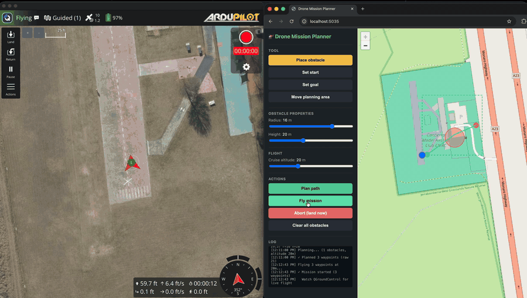

# 🚁 Drone Mission Planner


An end-to-end autonomous drone mission planner. Place obstacles on a real-world map, click "Plan," and watch a simulated drone fly the resulting path while you track it live.

Built as a capstone project combining **data structures (quadtree, A\*)**, **systems programming (cross-language bridges, MAVLink)**, and **web development (ASP.NET Core, Leaflet)** for UTSA EE4243/EE5123 and the Microsoft MSSA program.



> *The GIF above shows a complete mission: obstacle placement → A\* path planning → live flight in ArduPilot SITL with the drone's position streaming back to the browser map in real time.*

---

## ✨ Features

- **Drag-and-place obstacles** as circles with configurable radius and height
- **Movable planning area** — click anywhere on the world map to relocate the 100×100m planning grid
- **2.5D obstacle filtering** — a slider for cruise altitude live-updates which obstacles block the drone and which it can fly over
- **A\* path planning** with octile heuristic, corner-cutting prevention, and lazy closed set
- **Line-of-sight path smoothing** that typically reduces waypoint counts by 80–90%
- **Live drone tracking** — a blue drone icon updates on the map every second with a trail showing the actually-flown path
- **End-to-end execution** — the planned path is flown by a real flight controller (ArduPilot SITL) over MAVLink
- **Abort button** that switches the drone to LAND mode immediately

## 🏗️ Architecture
Each layer talks to its neighbors over a clean, standard protocol — REST for browser↔API, JSON-over-TCP for C#↔Python, MAVLink-over-UDP for Python↔ArduPilot. The same architecture works unchanged with a real Pixhawk-based drone in place of SITL.

## 🧠 How it works

### Quadtree

Obstacles are stored in a recursive **quadtree** — a spatial index that subdivides 2D space into four quadrants whenever a leaf exceeds capacity. Lookups become O(log n) instead of the O(n) of a flat list, which matters once you scatter dozens of obstacles across the planning area.

A 2.5D twist: obstacles store both a radius (2D footprint) and a height. When the grid is built for a given cruise altitude, obstacles shorter than `altitude - safety_buffer` are treated as fly-overable and excluded from blocking.

### A\* path planning

A grid is built from the quadtree, marking cells as free or blocked. **A\*** then searches the grid with:

- **8-connected neighborhood** (orthogonal + diagonal moves)
- **Octile heuristic** — the admissible heuristic for 8-connected grids, mathematically tighter than Euclidean or Manhattan distance
- **Corner-cutting prevention** — diagonal moves are rejected if either orthogonal neighbor is blocked, preventing paths that clip the corner of an obstacle
- **Lazy closed set** — closed-state checks happen at expansion time, not push time, which simplifies the priority queue logic

### Path smoothing

Raw A\* output is shaped like a staircase — one waypoint per grid cell. A **line-of-sight smoother** walks the path, finding the farthest waypoint visible in a straight line from each anchor, and discards the intermediate waypoints. The drone flies clean diagonals instead of stair-stepping along grid edges.

Typical reductions in test scenes:
- Wall scene: 21 → 4 waypoints (81% reduction)
- Corridor: 21 → 2 waypoints (90.5%)
- Maze: 21 → 3 waypoints (85.7%)

### Live drone tracking

The browser polls `GET /api/status` every second. The backend asks the Python bridge for current GPS, converts to local meters, and returns both. The browser draws an icon at the converted position and appends to the trail when the drone moves more than 1 meter from its last reported position.

## 📁 Project structure
## 🚀 Running it

### Prerequisites

- **macOS or Linux** (Windows might work but is untested)
- **.NET 10 SDK** — https://dotnet.microsoft.com/download
- **Python 3.12** — `pyenv install 3.12.11` recommended
- **ArduPilot** with SITL configured — https://ardupilot.org/dev/docs/setting-up-sitl-on-linux.html
- **QGroundControl** (optional but recommended) — https://qgroundcontrol.com/downloads/
- **pymavlink + MAVProxy**:
```bash
  pip install --break-system-packages "setuptools<81" pymavlink mavproxy pexpect
```

### One-time setup

```bash
git clone https://github.com/sarreola07/drone-mission-planner.git
cd drone-mission-planner

# Clone ArduPilot beside the other folders (it is gitignored on purpose)
git clone --recursive https://github.com/ArduPilot/ardupilot.git

# Add ArduPilot autotest tools to PATH
echo 'export PATH="$PATH:'"$(pwd)"'/ardupilot/Tools/autotest"' >> ~/.zshrc
source ~/.zshrc

# Build the C# projects
cd csharp
dotnet build
```

### Running the system

Four processes need to be running simultaneously. Use four terminal tabs.

**Terminal 1 — ArduPilot SITL:**
```bash
cd ardupilot
sim_vehicle.py -v ArduCopter --out 127.0.0.1:14550 --out 127.0.0.1:14551
```
Wait until you see `AP: ArduPilot Ready` and `STABILIZE>`.

**Terminal 2 — Python bridge:**
```bash
cd python_bridge
python3 drone_bridge.py
```
Wait until you see `Listening on 127.0.0.1:5555`.

**Terminal 3 — Web server:**
```bash
cd csharp
dotnet run --project DroneNavigation.Web
```
Wait until you see `Now listening on: http://localhost:5035`.

**Terminal 4 — QGroundControl (optional):**
```bash
open -a QGroundControl
```

Then open your browser to **http://localhost:5035**.

## 🧪 Testing

```bash
cd csharp
dotnet test
```

18 tests across:
- `QuadTreeTests` — insertion, query, subdivision
- `AStarTests` — pathfinding correctness, no-path scenarios, corner-cutting
- `PathSmootherTests` — line-of-sight, waypoint reduction, collision-free guarantees

## 🛣️ Roadmap

Working features today:
- ✅ Place / edit / delete obstacles
- ✅ Plan and fly missions
- ✅ Movable planning area
- ✅ Live drone tracking with trail
- ✅ Abort button
- ✅ 2.5D obstacle filtering with altitude slider

Planned but not yet implemented:
- ⏳ "Place drone anywhere" — restart SITL at a clicked GPS location
- ⏳ Status panel (mode, battery, GPS fix count)
- ⏳ Save / load named missions
- ⏳ Hardware deployment to a real Pixhawk-based hexacopter (Venator project)

## 👤 Author

**Sergio Arreola**
Microsoft Software Engineer trainee (MSSA) · Engineering student at UTSA
[github.com/sarreola07](https://github.com/sarreola07)

## 📄 License

MIT — see [LICENSE](LICENSE) for details.
